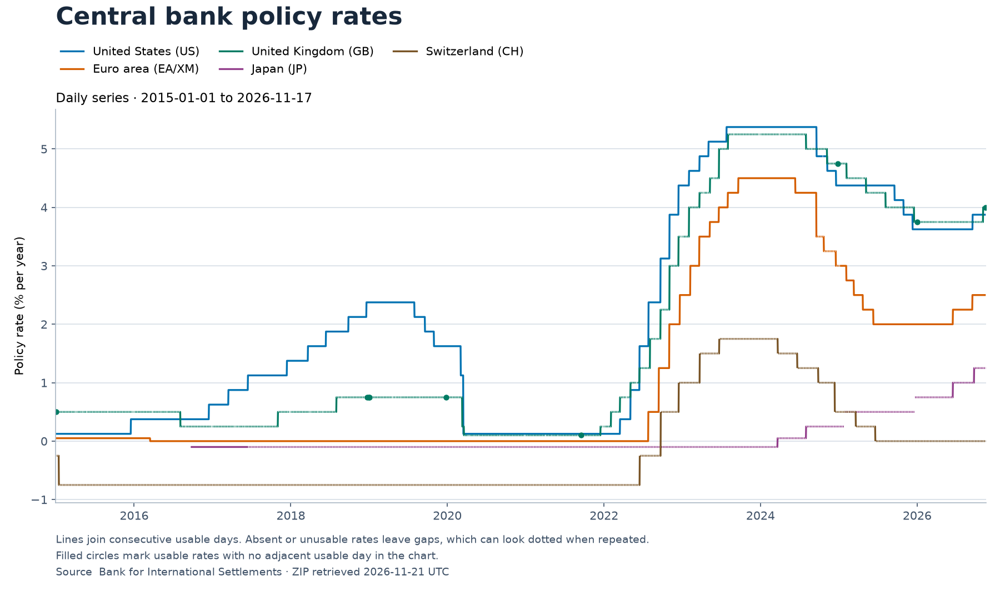

# BIS Policy Rate Monitor

BIS catalogue release **19 Nov 2026**. ZIP retrieved **2026-11-21 18:14 UTC**.

## Latest rates and 12-month changes

Rates are in per cent per year. Each date is the actual observation date for that area.

| Area | Latest rate (date) | 12-month rate (date) | Change (bp) | Status |
| --- | ---: | ---: | ---: | --- |
| United States (US) | 3.8750% (2026-11-17) | 3.8750% (2025-11-17) | 0 | Available |
| Euro area (EA/XM) | 2.5000% (2026-11-17) | 2.0000% (2025-11-17) | +50 | Available |
| United Kingdom (GB) | 4.0000% (2026-11-16) | 4.0000% (2025-11-14) | 0 | Available |
| Japan (JP) | 1.2500% (2026-11-17) | 0.5000% (2025-11-17) | +75 | Available |
| Switzerland (CH) | 0.0000% (2026-11-17) | 0.0000% (2025-11-17) | 0 | Available |

### Observation date notes

- **United Kingdom (GB).** The anniversary, 2025-11-16, has no daily observation in the source. The comparison uses 2025-11-14, 2 calendar days earlier.

## Daily policy rates

The chart starts on 2015-01-01. The comparison can use earlier observations.

## How the comparison works

For each area, we subtract one calendar year from its latest usable observation date. A 29 February date maps to 28 February when needed. We compare with the most recent usable observation on or before that anniversary.

One basis point (bp) is 0.01 percentage points. We subtract the historical rate from the latest rate and multiply by 100.

We flag a latest rate more than 7 calendar days before ZIP retrieval and a historical rate more than 7 calendar days before the anniversary.

## Data quality

- Across all areas, the analysis retained 709,984 daily observations and excluded 25,172 monthly rows. The daily observations include 70,058 dated missing values.
- BIS left `TIME_FORMAT` blank on 735,156 of 735,156 rows. We validated dates using the reported frequency (`FREQ`).

## Source

Bank for International Settlements, Central bank policy rates. [BIS Data Portal](https://data.bis.org/topics/CBPOL) · [Flat CSV ZIP](https://data.bis.org/static/bulk/WS_CBPOL_csv_flat.zip)

Archive SHA-256 `79f614ab22c21d172694cd48e9a9d551c7196f53c525008bc7ea4da8831d6494`.
